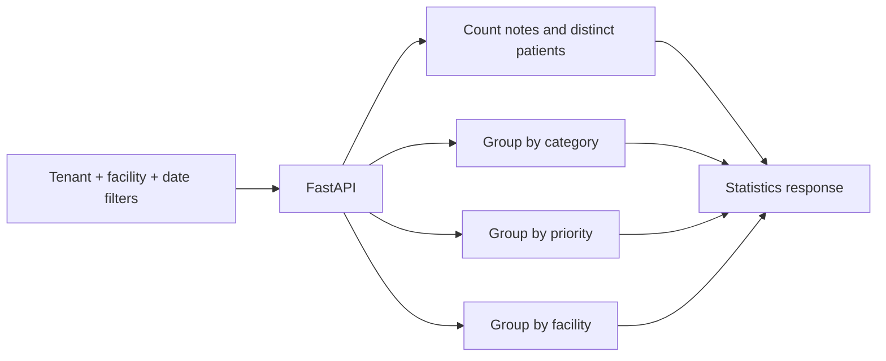

# Care-note statistics demo

A small FastAPI/SQLAlchemy example for comparing Python-side counting with SQL
aggregation over synthetic care-note records. It lists notes, accepts new notes
and summarizes categories, priorities and facilities for a selected tenant/date
range. The implementation is intentionally compact and SQLite-backed.

**Starting the API preserves existing notes.** Startup creates missing tables;
it neither drops tables nor automatically generates a large dataset. Demo data
is now an explicit command.

## Run a local example

```sh
git clone https://github.com/dev-nezuko/care-note-records-api.git
cd care-note-records-api/Test-backend
python3.11 -m venv .venv
source .venv/bin/activate
python -m pip install -r requirements.txt
python seed_demo.py --notes 1000
python -m uvicorn main:app --reload
```

Open `http://localhost:8000/docs` for the actual OpenAPI contract. The default
database is `carenotes.db` in the current directory; set `CARE_NOTES_DB_PATH` to
choose a different SQLite file. Sync schema setup and async queries use that
same file. The historical PostgreSQL Compose file is not the database path used
by this application and is not a verified PostgreSQL deployment recipe.

`seed_demo.py` appends synthetic records. To deliberately delete existing notes
and generate a fresh demo set, use `python seed_demo.py --reset --notes 1000`.
The reset flag is destructive; normal API startup never performs this reset.
The seeder accepts 1–1,000,000 records, with a default of 1,000.

## Implemented API

| Request | Purpose |
| --- | --- |
| `GET /api/care-notes` | List notes with optional tenant/facility filters and pagination |
| `POST /api/care-notes` | Create a note from the model's fields |
| `GET /api/care-stats` | SQL-aggregated counts for a tenant, optional facilities and date range |
| `POST /api/run-performance-test` | Run the included illustrative comparison and print its output |

There are no implemented per-note retrieve/update/delete routes, separate
`/api/analytics/*` routes or `/api/performance-test` endpoint.

```sh
curl 'http://localhost:8000/api/care-notes?tenant_id=1&page=1&page_size=20'
curl 'http://localhost:8000/api/care-stats?tenant_id=1&range=this_week&facility_ids=11,12'
```

Note pages return `notes` and `pagination` (`total`, `page`, `page_size`,
`total_pages`). Pages start at 1; page size is 1–100. Invalid page values return
`422`; malformed facility identifiers in the notes listing return `400`.

Statistics include total notes, category/priority/facility counts, notes per
distinct patient and the selected date range. Supported named ranges are
`today`, `this_week`, `this_month`, `this_year` and `all_time`; paired ISO
`start_date`/`end_date` values select a custom range.

## Where aggregation happens



The SQL path uses several grouped queries, not a single query or a materialized
analytics service. The model includes tenant/facility/date indexes. Neither
those indexes nor async endpoints establish a production scale claim. The
included benchmark is illustrative and was not used to produce new latency,
speedup or concurrency claims in this update.

## Verify startup and request boundaries

From `Test-backend/`:

```sh
python -m pip install -r requirements-test.txt
python -m unittest -v test_startup
```

Tests use a temporary database and synthetic fixtures. They verify that repeated
startup preserves a note and never invokes seeding, explicit seeding appends the
requested count, invalid pagination/facility inputs are rejected, and existing
notes remain readable. They do not establish performance or deployment readiness.

## Important boundaries

`tenant_id` is a caller-supplied filter, not authenticated tenant isolation.
The demo has no user authorization or verified production hardening. The create
route still accepts a model-shaped dictionary rather than a complete typed
validation policy. Use synthetic data only; do not treat this as a system for
real patient records. PostgreSQL migration, authentication and controlled
benchmarking are separate future work.
