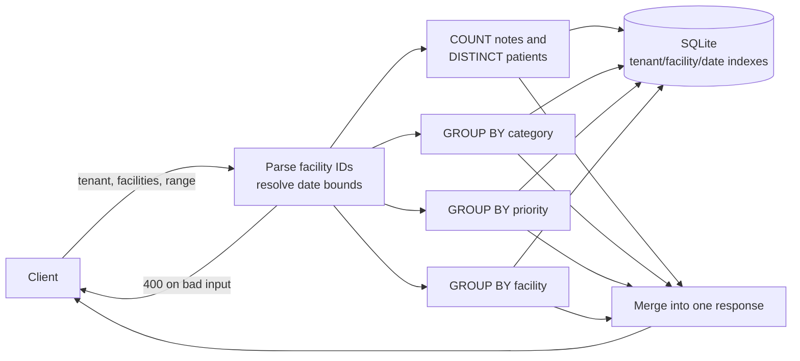

# Care-note records API

A small FastAPI + SQLAlchemy service over a SQLite table of care-home notes.
It lists and records notes for a tenant (a care provider) and its facilities,
and answers "what was logged, by category, priority and facility, over this
date range?" with SQL aggregation instead of loading every note into Python.
A built-in benchmark compares that against the naive in-memory approach on the
same data.

All data is synthetic. The seeder produces fictional residents (`DEMO-P11-09`)
and carers (`demo-carer-15`); do not load real patient records into this demo.

The code lives in [`Test-backend/`](Test-backend/).

## Run it with Docker Compose

From `Test-backend/`:

```sh
cp .env.example .env                  # optional: change the port or CORS origins
docker compose up -d --build --wait
docker compose run --rm api python seed_demo.py --notes 1000 --random-seed 7
```

The API is then on `http://localhost:8000`, with the OpenAPI contract at
`http://localhost:8000/docs`. The SQLite file lives on the `notes-data` volume,
so notes survive `docker compose restart`. `docker compose down -v` deletes it.

## Run it locally

Python 3.12 (see `Test-backend/.python-version`):

```sh
cd Test-backend
python3.12 -m venv .venv
source .venv/bin/activate
python -m pip install -r requirements.txt
python seed_demo.py --notes 1000
python -m uvicorn main:app --reload
```

The database defaults to `carenotes.db` in the working directory. Settings are
read from the environment (the app does not load `.env` by itself):

| Variable | Default | Purpose |
| --- | --- | --- |
| `CARE_NOTES_DB_PATH` | `carenotes.db` | SQLite file for the API and the seeder |
| `CARE_NOTES_CORS_ORIGINS` | `http://localhost:3000` | Comma-separated browser origins |
| `API_PORT` | `8000` | Host port published by Compose |

`seed_demo.py` appends notes (1 to 1,000,000; default 1,000) in one
transaction; 100,000 notes take about three seconds. `--random-seed N` makes
the data reproducible, and `--reset` drops the table first. Starting the API
only creates missing tables and never seeds or deletes anything.

## API

| Request | Purpose |
| --- | --- |
| `GET /api/care-notes` | Newest-first page of notes, optionally filtered by `tenant_id` and `facility_ids` |
| `POST /api/care-notes` | Record a note (validated; returns `201`) |
| `GET /api/care-stats` | Counts for one tenant over a date range, optionally per facility |
| `POST /api/run-performance-test` | Time in-memory counting against SQL aggregation |

The examples below were captured from the Compose stack after seeding 5,000
notes with `--random-seed 7`; long arrays are shortened.

### List notes

```sh
curl 'http://localhost:8000/api/care-notes?tenant_id=1&facility_ids=11,12&page=1&page_size=2'
```

```json
{
  "notes": [
    {"id": 1769, "tenant_id": 1, "facility_id": 11, "patient_id": "DEMO-P11-09",
     "category": "observation", "priority": 4, "created_at": "2026-11-07T14:35:10.857743",
     "created_by": "demo-carer-15",
     "note_content": "Synthetic demo note for fictional resident DEMO-P11-09"},
    {"id": 2287, "...": "..."}
  ],
  "pagination": {"total": 187, "page": 1, "page_size": 2, "total_pages": 94}
}
```

`page` starts at 1 and `page_size` is 1 to 100 (otherwise `422`). Facility IDs
must be positive integers (otherwise `400`). Notes with the same timestamp are
ordered by id, so pages never overlap.

### Record a note

```sh
curl -X POST http://localhost:8000/api/care-notes -H 'Content-Type: application/json' \
  -d '{"tenant_id": 1, "facility_id": 12, "patient_id": "DEMO-P12-07", "category": "observation",
       "priority": 2, "created_by": "demo-carer-03", "note_content": "Ate a full breakfast; mood settled."}'
```

```json
HTTP/1.1 201 Created

{"id": 5001, "tenant_id": 1, "facility_id": 12, "patient_id": "DEMO-P12-07", "category": "observation",
 "priority": 2, "created_at": "2026-11-09T00:11:26.934896", "created_by": "demo-carer-03",
 "note_content": "Ate a full breakfast; mood settled."}
```

`category` is one of `medication`, `observation` or `treatment`, and `priority`
is 1 to 5. `created_at` is optional (defaults to now) and is stored as UTC
whatever offset it is sent with. `tenant_id` and `facility_id` default to 1.
Unknown fields, including `id`, are rejected:

```json
HTTP/1.1 422 Unprocessable Entity

{"detail": [
  {"type": "literal_error", "loc": ["body", "category"],
   "msg": "Input should be 'medication', 'observation' or 'treatment'", "input": "gossip"},
  {"type": "less_than_equal", "loc": ["body", "priority"],
   "msg": "Input should be less than or equal to 5", "input": 9}
]}
```

### Statistics

```sh
curl 'http://localhost:8000/api/care-stats?tenant_id=1&range=this_month&facility_ids=11,12'
```

```json
{
  "total_notes": 77,
  "by_category": {"medication": 21, "observation": 30, "treatment": 26},
  "by_priority": {"1": 21, "2": 13, "3": 15, "4": 15, "5": 13},
  "by_facility": {"11": 26, "12": 51},
  "avg_notes_per_patient": 1.51,
  "date_range": {"start": "2026-11-01T00:00:00", "end": "2026-11-09T23:59:59.999999"}
}
```

`range` is `today` (the default), `this_week`, `this_month`, `this_year` or
`all_time` (open-ended; `date_range` is then `null` on both sides). For a custom
window, pass both `start_date` and `end_date` as ISO dates or datetimes. A bare
end date covers that whole day, and offsets are converted to UTC. Unknown ranges,
a lone or inverted bound, and malformed dates or facility IDs return `400`:

```json
{"detail": "start_date and end_date must be supplied together"}
```

### Benchmark

```sh
curl -X POST 'http://localhost:8000/api/run-performance-test?iterations=5&concurrency=5'
```

```json
{
  "tenant_id": 1, "facility_ids": [11, 12, 13, 14, 15], "day": "2026-11-04",
  "notes_in_window": 34, "results_match": true,
  "sequential": {"iterations": 5, "in_memory_avg_ms": 1.209, "sql_aggregate_avg_ms": 2.677},
  "concurrent": {"requests": 5, "in_memory_total_ms": 10.639, "sql_aggregate_total_ms": 11.313}
}
```

Both paths look at tenant 1's facilities on the day five days ago, and
`results_match` confirms they produced the same counts. `iterations` is capped
at 50 and `concurrency` at 20. The run above is honest about scale: with only
34 matching notes, four small grouped queries cost more than reading the rows
once. SQL aggregation pays off as the window grows, because the in-memory path
transfers every matching row and its `date()` filter keeps SQLite from using
the `created_at` index. Treat the numbers as illustrative, not as a capacity claim.

## How a statistics request is answered



Design notes:

- SQLite has no `GROUPING SETS`, so each breakdown is its own grouped query over
  the same filter, served by the `(tenant_id, facility_id, created_at)` and
  `(tenant_id, created_at, category)` indexes.
- Timestamps are stored as naive UTC. Every input path (custom ranges and new
  notes) normalises offsets before it touches the database.
- Schema creation uses a small synchronous engine at startup; requests use the
  async `aiosqlite` engine on the same file.

## Tests and lint

From `Test-backend/`, with the dev requirements installed:

```sh
python -m pip install -r requirements-dev.txt
python -m unittest discover -v
ruff check . && ruff format --check .
```

The 22 tests run against a throwaway SQLite file with synthetic fixtures. They
cover date-range edge cases, input validation, pagination, seeding, startup
safety and the benchmark's like-for-like comparison.

## Limitations

- `tenant_id` is a filter supplied by the caller, not an authenticated boundary.
  There is no authentication or authorisation.
- No per-note read, update or delete routes.
- SQLite with a single writer suits a demo, not a multi-instance deployment.

## License

[MIT](LICENSE)
